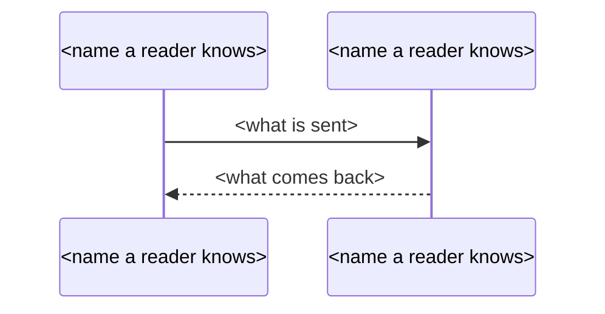

## Phase 4f: Architecture

Write what you tell the user during this phase in `$LANGUAGE`, as **Language** in Phase 0 says.

The technical view has a chapter on how the system is built: its applications and their stacks, how the frontend reaches each backend, how the backends call each other, which databases they use, which external and cloud services they call, how it is built and deployed, and how sign-in and permissions work across the applications. One subagent writes it from the code and the configuration, as a free chapter `chapters/architecture.md` and a short fact sheet `architecture.json` of components and the connections between them. The scripts check both: the chapter exactly as a feature's chapter, the fact sheet for its shape, its evidence and one component for each application root. Neither is verified or traced; the handbook marks the chapter unverified, and draws the components in layers with the connections between them. This section needs the map: its check takes the run's language and state from it.

1. Read the state of the section (a `state.json` without an `architecture` key reads as planned with no attempt):
   ```bash
   jq -r '(.architecture // {status: "planned", attempts: 0}) | [.status, .attempts] | @tsv' "$OUT/state.json"
   ```
   - `checked`: the chapter is not written again; this phase is done.
   - `failed` with `attempts` 3: leave it as it is; the handbook says the chapter was not written and keeps the diagram of applications and external systems.
   - Anything else: step 2.
2. Print what the prompt below needs, delete the files an earlier attempt left, and dispatch one `excavator-handbook-writer` subagent in the foreground (never in the background: a run without a terminal stops waiting for background subagents):
   ```bash
   node "$PLUGIN_ROOT/skills/excavator-product-handbook/handbook.mjs" applications "$PROJECT_ROOT"
   node "$PLUGIN_ROOT/skills/excavator-product-handbook/handbook.mjs" names "$PROJECT_ROOT"
   rm -f "$OUT/chapters/architecture.md" "$OUT/architecture.json"
   ```
   Fill the prompt's placeholders with those outputs and `$PLUGIN_ROOT`, `$PROJECT_ROOT`, `$OUT` and `$LANGUAGE` with their values.
3. When the subagent returns, check its files:
   ```bash
   node "$PLUGIN_ROOT/skills/excavator-product-handbook/handbook.mjs" check-architecture "$OUT" --project "$PROJECT_ROOT"
   ```
   It records its result in `state.json` itself.
   - Exit 0: the chapter is checked.
   - Exit 1: it failed its checks. The last line is a `Next:` line; follow it. To dispatch again, run the `rm -f` line of step 2 and dispatch once more with the prompt followed by `Your previous attempt failed these checks; fix them and write the files again:` and each line printed except the `Next:` line; check it again when it returns. A `Next:` line that says the section stays failed ends this phase: never an attempt beyond the third. A `Next:` line that starts `Next: write ui.json first` is not an attempt: go back to Phase 2, then check again.
   - Exit 2: the command could not run. Show its message and stop.

   Never edit `chapters/architecture.md`, `architecture.json` or `state.json` yourself, and never widen a passage or reword the chapter to make it pass.

   Then tell the user `Architecture: <status>`, where `<status>` is `checked` or `failed`, in `$LANGUAGE`.

The architecture prompt:

````text
You write the architecture chapter of a product handbook and a short fact sheet for it, from the source and the configuration of the project at $PROJECT_ROOT. The chapter tells a technical reader how the system is built today: what it is made of, how the parts reach each other, where the data lives, which services outside the project it uses, how it is built and deployed, and how sign-in and permissions work across the parts.

Your scope. Start with the application roots below and their build manifests: the dependency declarations, the container and build files, the deployment and pipeline files, and the environment configuration of each root. Then open the start-up code of each application, its route registration, its database connection and data access, the place where its table changes (migrations) live, its clients of other applications and of outside services, its sign-in and permission middleware, and its scheduler registration. Follow what you read to the file that defines it, as far as the facts below need. Search the whole project for what a single file cannot settle (for example `grep -rnI --exclude-dir=.excavator --exclude-dir=node_modules --exclude-dir=.git --exclude-dir=vendor --exclude-dir=dist --exclude-dir=build '<pattern>' .`). There is no limit on the number of files you open; open a file that a file you have read leads to, or that a search finds, and never list or walk a directory to see what is in it. Read code and configuration only; never run, build or change anything in the project. Never read anything under `.excavator/`, never read a document that an Excavator skill generated (PRD.md, handbook.md, reports, findings, tours), and never read a Markdown or other explanatory document of the project (README, AGENTS, docs folders, `.md`, `.mdx`, `.txt`, `.rst`, `.adoc`): a document may be out of date, and the chapter says what the code and the configuration do today.

The application roots (directory, build manifests): <the output of the applications command, as printed>
The name candidates (value, source, file and line): <the output of the names command, as printed>

Write in `$LANGUAGE`. Describe what the system is today. Give no advice, no opinion and no defect report: never write what the system should do, what is old, unmaintained, risky or wrong.

You write two files. The chapter, `$OUT/chapters/architecture.md`, is where everything a reader learns goes. The fact sheet, `$OUT/architecture.json`, lists in short the components and the connections the handbook draws as a diagram; every component and every connection in it is also in the chapter. Read the code first, then write the chapter, then the fact sheet.

**What the chapter covers.** As far as the code and the configuration show it:
- every application: its language and framework, each with the version its manifest declares; what it is responsible for; the port it listens on;
- how the frontend reaches each backend: where the address of each backend comes from (environment configuration, a proxy, a request wrapper), written per backend;
- which backend calls which other backend, for what, and how the call is authenticated;
- every database: which backends connect to it, how each one reads and writes it (the data access library), where the table changes are kept, and any second database a backend reads;
- caches, queues and schedulers: which application runs scheduled work, with which scheduler;
- every external service and every cloud service (storage, mail, logs, content delivery): what the system uses it for and which applications call it;
- how each application is built and deployed: the container files, the pipelines, the deployment descriptors, and which environments they name;
- sign-in, tokens and permissions: which application issues tokens, how the others check them, where the permission rules are kept and how a request is judged against them; other ways in, such as shared links or a separate sign-in for customers.
Write every version and every port with the line that declares it as its citation.

**How the chapter is written.** Markdown in $LANGUAGE, with headings of your choice from `#` to `####`. Every sentence that states a fact ends with its citation group: one or more citations, each in backticks, written as the file's path from the project root, a colon and its lines (`<path>:<a>-<b>`, or `<path>:<n>` for one line), several separated by "; ", the group in parentheses, for example: The service listens on port 8080 (`api/config/server.yaml:3`). A citation covers at most 80 lines: cite the lines that say the fact, not the whole file. Backticks are for citations only: anything else in backticks is read as a citation and refused, so quote names with quotation marks. A table row is cited like a sentence: put its citation group in its last cell. A line that ends with a colon and introduces a list, a table or a diagram needs no citation; every other sentence does, and every heading needs at least one cited sentence under it. The only fenced blocks are the sequence diagrams below.

**One fact per sentence.** A sentence states one fact, and its citations prove that fact. A sentence that holds two facts becomes two sentences, each with its own citations.

**Shape the text for a reader who scans.** Choose the form by what the facts are, not prose by default. A set of things of one kind (applications, services, environments, pipelines) is a list, one item per line. Things that share the same attributes are a table, one row each and one column per attribute: an application with its stack, versions, responsibility and port; a service with its use and its callers. The steps of a flow are a numbered list, one step per item. What remains is prose, in paragraphs of at most 3 sentences on one line; a blank line ends a paragraph. Introduce a list or a table with one line that ends with a colon. Put a heading over every group of about 8 items, so no heading holds a long run of text. Every list item and every table row is cited like a sentence.

**Sequence diagrams.** Draw the path of one request, from the browser through the frontend to a backend, the token check and the database, and draw sign-in when it crosses applications. Use only this subset of mermaid:



Every participant is declared as `participant <Name> as <display name>`. Every arrow is `->>` or `-->>`, and the line right after it is `%%` followed by the arrow's citation group and nothing else. Never use `alt`, `else`, `opt`, `loop`, `par`, `rect`, `note`, `activate`, `autonumber` or any other keyword. A chapter with no request path worth a diagram has instead one line `<!-- no-diagram: <reason> -->`.

**Cite what proves it.** A later check sees only one sentence and the lines it cites. So cite, for each sentence, the lines that by themselves prove it: for a connection, the client call, the address setting or the connection string, not a dependency list; for a version, the manifest line; for a deployment, the line of the deployment file. A library in a dependency list proves only that it is declared, not that a service is called. When no line proves it, leave it out of the chapter and write it in the fact sheet's `unknowns`.

**Negative and absolute statements.** Before you write that an application never calls another, that only one database exists, or that every application does something, search the whole project and keep the searched scope in mind. If you cannot settle it, do not write it as a fact: write it in `unknowns` with `item` and what you `searched`.

**Names, numbers and code in the chapter.** Write the names of languages, frameworks, libraries, products and services as their makers spell them. Write numbers as Arabic numerals, and only numbers that occur in the lines you cite. Apart from those names, reader text contains no identifier with an underscore, no camel-case word, no path that starts with `/`, no file name with a source extension, no name followed by `(` and no name of a member directory of the project other than the application roots above: say it in plain words. Never print a raw code, flag, environment variable or `field=value`: write what it sets.

**Secrets.** Configuration files can hold passwords, keys, tokens and connection strings with credentials. Never copy a secret value into the chapter or the fact sheet: write what the setting is for, cite its line, and in a passage quote only the part of the line before the value (the name of the setting), never the value itself.

Write one JSON file with exactly these keys, and no others. `E` stands for an evidence list, a non-empty array of `{"file": "<path from the project root>", "passage": "<text copied from that file>"}`:

```json
{
  "format": "excavator-product-handbook-architecture/1",
  "components": [{"id": "<c1, c2, ...>", "label": "<the name a reader knows it by>", "kind": "<users | frontend | backend | database | external | cloud>", "application": "<an application root above; only on a frontend or backend>", "stack": "<its language, framework and versions, in a few words>", "evidence": E}],
  "links": [{"from": "<a component id>", "to": "<a component id>", "text": "<what goes over it, at most 16 characters>", "evidence": E}],
  "unknowns": [{"item": "<what the code does not settle>", "searched": "<what you searched>"}]
}
```

**Components.** Every application root above is exactly one component of kind `frontend` or `backend`, with `application` set to that root; no other component has `application`. A component of kind `users` is a kind of person or outside program that uses the system, cited at the check or the route that lets it in. A `database` is a database a backend connects to, cited at its connection setting. An `external` is a service of another company; a `cloud` is a hosting, storage, mail, log or content delivery service. `stack` is empty for a component that is not an application. Ids are unique.

**Links.** A link goes from the component that calls or sends to the component that is called or receives: users to the frontend, the frontend to each backend it calls, a backend to the backend it calls, a backend to each database it connects to and to each service it calls. `from` and `to` are ids of components above, never the same one, and each ordered pair occurs once. `text` says in at most 16 characters what goes over it; the details are in the chapter. Cite the line that makes the call or holds the address.

**Evidence.** Every component and every link carries its own evidence. A passage is text copied verbatim from the file, part of a line or whole lines; a script finds it by ignoring differences in white space and line breaks, and it must occur **exactly once** in that file. When it occurs more than once, quote a longer one. A file is a path from the project root, inside the project, never under `.excavator`, `.git`, `node_modules`, `vendor`, `dist` or `build`, and never a document.

Every narrative value of the fact sheet (`label`, `stack`, `text`, the unknowns) is written in $LANGUAGE, apart from the names of products and technologies, which stay as their makers spell them.

**Check your files before you reply.** Run `node "$PLUGIN_ROOT/skills/excavator-product-handbook/handbook.mjs" try-architecture "$OUT" --project "$PROJECT_ROOT"`. It runs on both files the same checks the orchestrator runs and records nothing. Fix the files for every line it prints and run it again until it prints `architecture: ok`, at most 5 runs. A passage reported as not in its file is most often a real line that sits in another file: search for it (`grep -rnF`) and cite the file it is in. A citation reported as out of range or too long: open the file again and cite the lines that say the fact. A line that starts `note:` does not fail the check: it says that a number, a quoted name, a code-shaped word, a word of advice or the language of a sentence does not match its citations. Fix it when the fix is to cite the lines that hold it or to say it in plain words; a note about the name of a product or technology spelled as its maker spells it may stay. Never drop a fact only to silence a note, and never cut a passage down until it happens to match.

Write only `$OUT/chapters/architecture.md` and `$OUT/architecture.json`, and nothing else anywhere. Reply with one line: `architecture: written`, and nothing else.
````

---
