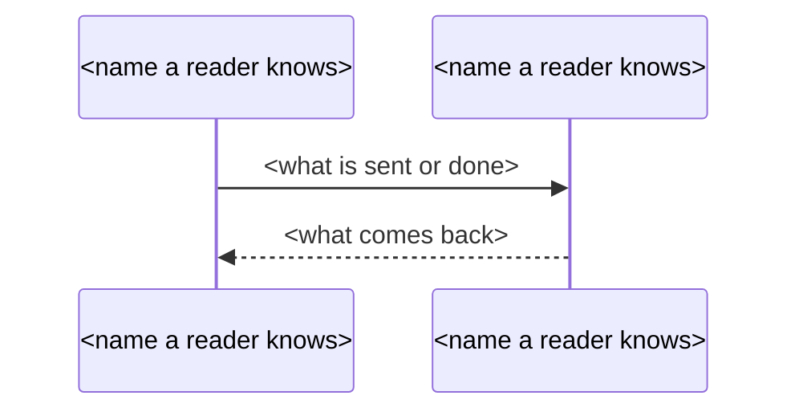

## Phase 4: Entries

Write what you tell the user during this phase in `$LANGUAGE`, as **Language** in Phase 0 says.

The code of a feature is read once. One lane per feature writes, in that one read, the chapter and the fact sheet of the feature and, when the section `findings` is selected, the findings of its code, the defects the code shows today (a unit with the id `<id>.findings`, where `<id>` is the feature's id). Each file is checked by its own command and recorded with its own state and attempts: the entry (the chapter and the fact sheet together) by `check-entry`, the findings by `check-findings`. The scripts check the findings with the checks of an entry and one more, the words of advice, and record the unit `checked`, which is final: the findings go into the handbook as they were written, marked as not verified. A findings unit does not depend on the feature's entry: it is written and checked whether or not the entry is, and its findings are in the handbook either way. A feature may have no finding: the lane writes an empty list, and the script records the unit as verified at once. A retry asks the lane only for the file that did not pass; a file that passed keeps its state.

1. List the lanes this run dispatches. `<ids>` is `$SELECTED` space-separated, or empty without `--features`. A `state.json` without a `findings` key, as an output directory from before the findings has, reads as every findings unit planned with no attempt:
   ```bash
   jq -r --arg ids "<ids>" '($ids | split(" ") | map(select(. != ""))) as $want | .features | to_entries[] | select(($want | length) == 0 or (.key | IN($want[]))) | [.key, .value.status, .value.attempts] | @tsv' "$OUT/state.json"
   jq -r --arg ids "<ids>" '($ids | split(" ") | map(select(. != ""))) as $want | (.findings // {}) as $found | .features | to_entries[] | select(($want | length) == 0 or (.key | IN($want[]))) | [(.key + ".findings"), ($found[.key].status // "planned"), ($found[.key].attempts // 0)] | @tsv' "$OUT/state.json"
   jq -r '.features[] | [.id, .reach, .name] | @tsv' "$OUT/map.json"
   ```
   The first command lists the entries, the second the findings units (the second is needed only with `findings` in `$SECTIONS`). This phase takes only the features of the section `features`: with `features` not in `$SECTIONS` it dispatches no lane, and a run that selects `findings` alone goes to Phase 4c.

   A feature gets a lane when its entry is to be written. A feature that is `checked`, `confirmed` or `verified` is not written again. A feature that is `dispatched` and has an entry file (an earlier run stopped after its lane wrote) goes to step 3 first, as if its lane had just returned. Every other feature with `attempts` below 2 gets a lane; one with `attempts` 2 that is not `checked`, `confirmed` or `verified` stays as it is. A feature that is `failed` with `attempts` 1 (an earlier run stopped before its second attempt) gets its second attempt as step 3 describes, with the reasons `state.json` kept from the first: `jq -r '.features["<id>"].failure.reasons[]' "$OUT/state.json"`. Before you dispatch a lane again, delete the files its earlier attempt left: `rm -f "$OUT/entries/<id>.json" "$OUT/chapters/<id>.md"`.

   With `findings` in `$SECTIONS`, the lane also writes the findings file `entries/<id>.findings.json` when its unit is still to write, by the same rules: a unit that is `checked`, `confirmed` or `verified` is not written again; one that is `dispatched` and has a findings file goes to step 3 first; every other unit with `attempts` below 2 is written; one with `attempts` 2 that is not `checked`, `confirmed` or `verified` stays as it is; one that is `failed` with `attempts` 1 gets its second attempt with the reasons `state.json` kept, `jq -r '.findings["<id>"].failure.reasons[]' "$OUT/state.json"`. Before the file is written again, delete the file its earlier attempt left: `rm -f "$OUT/entries/<id>.findings.json"`. The lane's files, the entry's and the findings', are the ones the block **Your files** of its prompt lists, and no others.

   Dispatch a lane for every feature step 1 lists, whatever the run has spent: never leave a feature unwritten to keep budget or time for later phases, and never plan to mark unwritten features in the handbook instead. When the run cannot go on, stop; the next run resumes from `state.json` without writing again what is written.
2. Right before you dispatch lanes, record their dispatches: `<id>` for the entry, and `<id>.findings` for the findings file when the lane writes it. Put the `mark` calls of one batch in one Bash command, one after another, before the message that dispatches the batch, one line per lane and file:
   ```bash
   node "$PLUGIN_ROOT/skills/excavator-product-handbook/handbook.mjs" mark "$OUT" <id> dispatched --project "$PROJECT_ROOT"
   node "$PLUGIN_ROOT/skills/excavator-product-handbook/handbook.mjs" mark "$OUT" <id>.findings dispatched --project "$PROJECT_ROOT"
   node "$PLUGIN_ROOT/skills/excavator-product-handbook/handbook.mjs" mark "$OUT" <next id> dispatched --project "$PROJECT_ROOT"
   ```
   Dispatch at most `$CONCURRENCY` lanes in one message so they run concurrently, each an `excavator-handbook-writer` subagent in the foreground with the prompt below. Fill in only the placeholders of its last blocks, **Your feature** and **Your files**, from `map.json` and `candidates.json`, and write `$PLUGIN_ROOT`, `$PROJECT_ROOT`, `$OUT` and `$LANGUAGE` as their values everywhere; leave the rest of the prompt exactly as written, `<id>` included, so that every lane of the run starts with the same text. Each feature has one lane in this phase: never a second subagent for the findings of a feature. Wait for every lane of the message to return before you send the next; never in the background: a run without a terminal stops waiting for background subagents.
3. As each lane returns, check it: the entry first, then the findings file when the lane wrote it. Run `check-entry` for one lane at a time, as each returns, never two at once:
   ```bash
   node "$PLUGIN_ROOT/skills/excavator-product-handbook/handbook.mjs" check-entry "$OUT" <id> --project "$PROJECT_ROOT"
   node "$PLUGIN_ROOT/skills/excavator-product-handbook/handbook.mjs" check-findings "$OUT" <id>.findings --project "$PROJECT_ROOT"
   ```
   `check-entry` records its result in `state.json` itself: `checked`, or `failed` with the lines it printed as the reasons. A lane that wrote no file fails with `lane-wrote-nothing`. `check-findings` records the findings unit the same way: `checked`, `verified` when the file holds no finding (there is nothing to prove), or `failed` with the lines it printed as the reasons.
   - Exit 0: the entry is checked, which is final: the handbook writes the feature with its chapter under a sentence that says it is not verified. The chapter alone can be checked again, recording nothing, with `node "$PLUGIN_ROOT/skills/excavator-product-handbook/handbook.mjs" check-chapter "$OUT" <id> --project "$PROJECT_ROOT"`. For `check-findings`, exit 0 means the findings are checked, or verified with none.
   - Exit 1: the entry failed its checks. The last line it prints is a `Next:` line. Follow it:
     - `Next: delete <id>'s entry, mark it dispatched and re-dispatch it once with the lines above (attempt 2 of 2)`: delete the entry and the chapter (`rm -f "$OUT/entries/<id>.json" "$OUT/chapters/<id>.md"`), mark the dispatch (as in step 2) and re-dispatch the lane once with its prompt followed by this line and then each line `check-entry` printed except the `Next:` line: `Your previous attempt failed these checks; fix them and write the file again:`. Check it again when it returns.
     - `Next: <id> stays failed (2 of 2 attempts)`: leave the feature failed, with its file kept for the user to see. Never make a third attempt.
     - A `Next:` line that starts `Next: write ui.json first`: the fixed text of a non-English run is missing or fails `check-ui`, nothing was recorded and this is not an attempt. Stop dispatching, go back to Phase 2, then check this lane again.
   - Exit 1 of `check-findings`: the findings file failed its checks, with a `Next:` line as the entry's. Follow it the same way for the findings unit: `Next: delete <id>.findings's entry, mark it dispatched and re-dispatch it once with the lines above (attempt 2 of 2)` means delete the file (`rm -f "$OUT/entries/<id>.findings.json"`), mark the dispatch (`<id>.findings`, as in step 2) and re-dispatch the lane once, with the lines `check-findings` printed except the `Next:` line in place of the entry's; `Next: <id>.findings stays failed (2 of 2 attempts)` leaves the unit failed, with its file kept for the user to see: never a third attempt; a `Next:` line that starts `Next: write ui.json first` is not an attempt, as above.
   - A lane whose entry passed and whose findings failed, or the other way round, is dispatched again only for the file that failed: the re-dispatch's prompt lists only that file in **Your files** and is followed by the line `Your previous attempt failed these checks; fix them and write the file again:` and the lines of that file's check. The state of the file that passed, and the file itself, are not touched: do not delete them and do not mark them. When both files failed, one re-dispatch asks for both, with the lines of both checks, each group under the id of its unit. Check what it wrote again when it returns.
   - Exit 2: the command could not run. Show its message and stop.

   Never edit `entries/<id>.json`, `chapters/<id>.md` or `state.json` yourself, and never widen a passage or reword an entry to make it pass. Never edit `entries/<id>.findings.json` yourself either, and never widen a passage or reword a finding to make it pass. A lane that fails its checks is fixed only by its own second attempt. Statuses and attempts change only through these commands.

   Then tell the user `Lane <id> <n>/<N>: <status>`, where `<n>` counts the lanes this run has checked, `<N>` is the number of lanes listed in step 1 and `<status>` is `checked` or `failed`, in `$LANGUAGE`; when the lane wrote the findings file, also `Findings <id> <n>/<N>: <status>`, where `<status>` is `checked` or `failed` (a unit with no finding counts as checked), in `$LANGUAGE`.

4. When every lane of this run has been checked, draw the flow of each business domain. Skip this step when `$OUT/domains.json` does not exist (the handbook then groups the features by area), when no feature is `checked` or `verified`, or when `jq -r '.domainFlows.status // ""' "$OUT/state.json"` prints `failed` and `jq -r '.domainFlows.attempts // 0' "$OUT/state.json"` prints 3. Skip it too when it prints `checked` and no lane was checked in this run.

   A domain's flow shows a reader the main line of work through the domain: which feature hands over to which, and the states a record goes through. Choosing that line out of all the hand-overs, states and steps is your judgment; the script checks that every node and every edge comes from the entries. Read what you choose from:
   ```bash
   jq -r '.domains[] | [.id, .name, (.features | join(" "))] | @tsv' "$OUT/domains.json"
   for f in "$OUT"/entries/F*.json; do jq -c '{id, handoffs: ([.handoffs[]?, (.operations[]?.handoffs[]?)] | map({feature, text})), states: [.states[]?.label], transitions: [.transitions[]? | {from, to, by}]}' "$f"; done
   jq -r '.features | to_entries[] | select(.value.chapter) | .key as $id | .value.chapter.items[] | select(.kind != "heading") | [$id, .id, (.own // .claim)] | @tsv' "$OUT/state.json"
   ```
   Then write `$OUT/domain-flows.json` in this shape, one object per domain you draw (a domain you leave out has no flow):
   ```json
   {"format": "excavator-product-handbook-domain-flows/1",
    "domains": [{"domain": "<domain id>",
      "nodes": [{"id": "n1", "feature": "<feature id>"},
                {"id": "n2", "state": {"feature": "<feature id>", "label": "<state label as the entry writes it>"}},
                {"id": "n3", "item": {"feature": "<feature id>", "item": "chapter.<n>"}, "text": "<words copied from that item>"}],
      "edges": [{"from": "n1", "to": "n2", "text": "<optional>"}]}]}
   ```
   - A node is a feature of that domain that is in the handbook, a state of the entry of such a feature, or one item of its chapter. An item node's `text` is 1 to 24 characters copied exactly from that item's own text.
   - An edge is one of four kinds, and nothing else: from a feature to a feature it hands over to; from a state to a state, when the entry has that transition; from an item to a later item of the same chapter; between an item and a state whose label occurs in that item's text. An edge's `text` may be left out; when given, it is 1 to 12 characters copied exactly from the hand-over's text, the transition's cause or the item's text.
   - Keep each flow readable: the main line, about 4 to 12 nodes.

   Check the file:
   ```bash
   node "$PLUGIN_ROOT/skills/excavator-product-handbook/handbook.mjs" check-domain-flows "$OUT" --project "$PROJECT_ROOT"
   ```
   Exit 0: the flows are checked. Exit 1: it prints each node or edge that does not match, with its domain and the reason, and a `Next:` line. Follow it: fix `domain-flows.json` for every line it printed and run it again; after the third failure it prints `Next: the domain flows stay failed (3 of 3 attempts); the handbook draws none`, and the handbook says so on each domain page. Fix the cause, never the check: never edit an entry, a chapter or `state.json` to make an edge pass. Exit 2: the command could not run; show its message and stop.

   Then tell the user, in `$LANGUAGE`, how many domains have a flow, or that the flows failed their checks.

The lane prompt:

````text
You write one chapter of a product handbook and a short fact sheet for it, and the findings of the same feature, for readers who do not read code, from the source of the project at $PROJECT_ROOT. You read the code of the feature once and write every file you are asked for from that one read. The last blocks of this prompt, **Your feature** and **Your files**, say which feature you write, where its code starts, which other features exist, which roles and names you may use and which of the files below you write this time: the chapter and the fact sheet, the findings, or both. The parts of this prompt that describe a file you are not asked for do not apply to this run: skip them. In this prompt `<id>` stands for the id of your feature.

Your scope. Start with the seed files of your feature. Beyond them, open the files that **Following out of the seed files** leads you to, and search the whole project as that paragraph and **Negative and absolute statements** ask. A defect that belongs to another feature is written by that feature's lane, and the other features are listed in the last block. Read code only; never run, build or change anything in the project. Never read anything under `.excavator/` and never read a document that an Excavator skill generated (PRD.md, handbook.md, reports, findings, tours), nor any other Markdown or document file of the project (README, AGENTS, PRD, specifications); every path you open is project source or configuration. Exclude `.excavator`, `.git`, `node_modules`, `vendor`, `dist` and `build` from every search (for example `grep -rn --exclude-dir=.excavator --exclude-dir=node_modules ...`).

Write in `$LANGUAGE`, in plain words for a reader who does not read code. Describe what the product does today. Give no advice, no opinion and no defect report in the chapter and the fact sheet: never write what the product should do or what is wrong with it there. The defects of the feature are written only in the findings file, as **The findings of the feature** says.

You write up to three files: two for the entry and one for the findings. The chapter, `$OUT/chapters/<id>.md`, is where everything a reader learns about the feature goes. The fact sheet, `$OUT/entries/<id>.json`, repeats in short the facts the handbook gathers across features (who, where, screens by name, hand-overs, states, notifications, automatic behavior, open questions); every fact in it is also in the chapter. The findings file, `$OUT/entries/<id>.findings.json`, holds the defects the code of the feature shows today, as **The findings of the feature** says. Read the code first, then write the chapter, then the fact sheet, then the findings.

**What the chapter covers.** As far as the code shows it: what the feature is for and who uses it; where it is in the menu and its routes; every screen, with its fields, filters, columns, buttons and the messages it shows; every operation the user can do and what happens step by step, in the frontend and the backend; every rule and check, with its exact condition, and every exception as its own sentence; every calculation, with its inputs, rate, rounding and cap; the states a record goes through and which action moves it from one to the next; every notification, with its trigger, recipient, channel and content; what happens automatically (schedules, events, listeners); where the feature hands over to another feature, without describing the other feature's own flow. Every displayed or computed number gets its calculation and inputs; every configurable item says what configuring it does.

**How the chapter is written.** Markdown in $LANGUAGE, with headings of your choice from `#` to `####`. Every sentence that states a fact ends with its citation group: one or more citations, each in backticks, written as the file's path from the project root, a colon and its lines (`<path>:<a>-<b>`, or `<path>:<n>` for one line), several separated by "; ", the group in parentheses, for example: The request is saved as a draft (`src/requests/save.ts:40-52`; `src/requests/model.ts:12`). A citation covers at most 80 lines: cite the lines that say the fact, not the whole file or function. Backticks are for citations only: anything else in backticks is read as a citation and refused, so quote labels with quotation marks. A table row is cited like a sentence: put its citation group in its last cell. A line that ends with a colon and introduces a list, a table or a diagram needs no citation; every other sentence does, and every heading needs at least one cited sentence under it. The only fenced blocks are the sequence diagrams below.

**One fact per sentence.** A sentence states one fact, and its citations prove that fact. A sentence that holds two facts becomes two sentences, each with its own citations. Write a flow in as many sentences as the code has hops, and give each trigger, calculation, change, boundary case, error and hand-over its own sentence and its own citation. A step cites its own hop: the handler, the call, the query or the condition that does that step.

**Shape the text for a reader who scans.** Choose the form by what the facts are, not prose by default. A set of things of one kind (types, fields, columns, filters, buttons, options, conditions, exceptions) is a list, one item per line. Things that share the same attributes are a table, one row each and one column per attribute: a field with its label, whether it is required and its rule; a state with its meaning and what moves it on; a notification with its trigger, recipient, channel and content. The steps of a flow are a numbered list, one step per item. What remains is prose, in paragraphs of at most 3 sentences on one line; a blank line ends a paragraph. Introduce a list or a table with one line that ends with a colon. Put a heading over every group of about 8 items, so no heading holds a long run of text. Every list item and every table row is cited like a sentence. The form changes how the facts are laid out, never how many: every fact that **What the chapter covers** asks for is still written, as its own list item, table row or sentence, and a section of the code you read is still a section of the chapter. Never merge several conditions, exceptions, notifications or calculations into one row or one item to keep a table short, and never leave out a calculation, a notification or another service that serves the feature because it does not fit a table.

**Sequence diagrams.** Draw one sequence diagram for each main operation of the feature: what the user does, from the action to the data it changes, across the frontend and the backend, and where it hands over. Use only this subset of mermaid:



Every participant is declared as `participant <Name> as <display name>`. Every arrow is `->>` or `-->>`, and the line right after it is `%%` followed by the arrow's citation group and nothing else. Never use `alt`, `else`, `opt`, `loop`, `par`, `rect`, `note`, `activate`, `autonumber` or any other keyword: write a condition as a sentence with its own citation, or as an arrow of its own. A chapter that has no operation worth a diagram has instead one line `<!-- no-diagram: <reason> -->`.

**Following out of the seed files.** The seed files are where you start, not a fence. When a file you have read hands part of your feature to code in another file, follow it there: find where the imported module, the called function or method, or the constant, enum, template, message text, validation rule or component it uses is defined (search with `grep -rn`; in a language whose package spans the files of one directory, such as Go, the files beside a seed call each other without an import), and open that file. When code emits an event, publishes a message or puts a job on a queue, search the whole project for that name, find every listener or consumer, and write one hand-over sentence in this chapter (who takes over, what it does) without describing the other feature's own flow. Follow every decision a reader sees to the code that makes it: who receives a notification and what it says; how a displayed or computed number is calculated, with which rate, rounding and cap, and from which date or input; when a step of an approval or a flow is skipped or added; which columns a list shows, how it is sorted by default and how it can be filtered; what a detail page shows. A function's name does not say which records it returns or which people it picks (a word such as all, list or a role name in it settles nothing): before you write who receives something, who may act or which records count, open the function and write the filters its query applies, or write the claim without "all" and "every". When several handlers or categories share a field or a step, check each one before you say where its value comes from (which date, which input, which rate), and say it per handler when they differ. Before you write an item in `unknowns`, follow the call or import that could settle it. There is no limit on the number of files you open. Open a file that a file you have read leads to, or that a search finds, and never list or walk a directory to see what is in it. In a file another feature also uses, read only what your feature uses. For the findings file, a finding cites passages in the seed files and in at most 20 other files in all; searches and the files you open for the chapter do not count unless a finding cites them. When the 20 are spent, cite no more files: write what is not settled in `unknowns`, and say in `searched`, in plain words, what you did not open.

**Exceptions before a general rule.** Before you write a rule that you state for every type, for every office or region, or for everyone, look for the branches that keep it from being general: an early branch by type, where one type takes its own path before the common code; the sets of offices or regions, read separately in the frontend and in the backend (when the two sets differ, write them separately, each with its own citation); the acting person being the approver or the leader of the request; a switch that skips, defers or turns off a step; a fixed error text that is shown only when the server sends no message of its own. Write the main rule with its condition, and write each exception as its own sentence with its own citation, so that the main rule does not claim more than the code does.

**Cite what proves it.** A later check sees only one sentence and the lines it cites. So cite, for each sentence, the lines that by themselves prove it. For who may do something, cite the condition the code checks (the comparison, the role test, the guard that lets one role in and keeps another out), not the name of a function or variable: a name that contains a role word says nothing about who may act. For a claim of "every", "any" or "cannot already", cite the whole condition, so that a narrower one cannot hide outside the cited lines. When no line proves it, leave it out of the chapter and write it in the fact sheet's `unknowns`.

**Negative and absolute statements.** Before you write that something is never sent, never checked, not done, always done or done regardless of a setting, and before you write a finding that something is missing, and before you write a trigger ("done by the nightly job", "recalculated by an event") or an ordering ("checked before"), search the whole project (every module, listeners and their registrations, scheduler registrations, SQL and migration scripts, configuration) and keep the searched scope in mind. If you cannot settle it, do not write it as a fact or as a finding: write it in `unknowns` with `item` and what you `searched`.

**Labels, numbers and code in the chapter.** Keep every label, button text, state name and type name exactly as the source writes it, in the source's language, in quotation marks: never translate a label. Quotation marks hold only text copied from the source; your own words, translations and summaries take no quotation marks. Write numbers as Arabic numerals ("2 levels", never "two levels"), and only numbers that occur in the lines you cite. Reader text contains no identifier with an underscore, no camel-case or mixed-case word, no path that starts with `/`, no file name with a source extension, no name followed by `(` and no name of a member directory of the project, except a quoted label and the names listed at the end: say it in plain words. Never print a raw code, flag or `field=value`: read the enum or constant and write its meaning.

Every narrative value of the JSON file below is written in $LANGUAGE: the purpose, what a role can do, the hand-overs, the meanings of states, how a state changes, the parts of a notification, the automatic behavior and the unknowns. Labels, screen names, `where` labels and the roles stay exactly as the source and the lists at the end write them.

Write one JSON file with exactly these keys, and no others. `E` stands for an evidence list, a non-empty array of `{"file": "<path from the project root>", "passage": "<text copied from that file>"}`:

```json
{
  "format": "excavator-product-handbook-entry/3",
  "id": "<id>",
  "purpose": {"text": "<one plain sentence: who uses the feature to do what>", "evidence": E},
  "who": [{"role": "<a label from the list of roles>", "can": "<what this role can do here>", "evidence": E}],
  "where": [{"label": "<menu group, menu item, tab or page title, one per step>", "evidence": E}],
  "screens": [{"name": "<screen title as shown>", "evidence": E}],
  "handoffs": [{"feature": "<the id of another feature from the list at the end>", "text": "<what is handed over to it>", "evidence": E}],
  "states": [{"label": "<status as shown>", "meaning": "<what it means>", "evidence": E}],
  "transitions": [{"from": "<status label as shown>", "to": "<status label as shown>", "by": "<what causes the change>", "evidence": E}],
  "notifications": [{"trigger": "<when>", "recipient": "<who gets it>", "channel": "<how>", "content": "<what it says>", "evidence": E}],
  "automatic": [{"when": "<schedule or trigger>", "effect": "<what happens>", "evidence": E}],
  "unknowns": [{"item": "<what the code does not settle>", "searched": "<what you searched>"}]
}
```

Every key is always there: when a part does not apply to your feature, write an empty list (`"notifications": []`), never leave the key out and never add a key. `unknowns` has no evidence. Screens carry only their names; their fields, rules and flows are in the chapter. A hand-over's `feature` is the id of one of the other features listed at the end, never your own id, and `text` says what is handed over. `transitions` are the changes between the states you list: `from` and `to` are state labels exactly as the source writes them and must occur in the item's own passages, `by` says in words what causes the change.

**Evidence.** Every item of the fact sheet and every finding carries its own evidence. A passage is text copied verbatim from the file, part of a line or whole lines; a script finds it by ignoring differences in white space and line breaks, and it must occur **exactly once** in that file. When a passage occurs more than once, quote a longer one (the whole line, or the lines around it). A file is a path from the project root, inside the project, and never under `.excavator`, `.git`, `node_modules`, `vendor`, `dist` or `build`. An item may cite several passages; each is checked. The purpose is one plain sentence saying who uses the feature to do what, citing the screen or handler that shows it; conditions, filters and limits belong in the chapter, not in the purpose.

**Labels and numbers must be in the item's own passages.** Every `label`, every screen `name` and every `where` label must occur in that item's own passages, exactly as the source writes it, in the source's language: never translate a label. Every number in your text must occur as a number in that item's own passages (the script ignores thousands commas, and underscores between digits in the source). Write numbers as Arabic numerals. A hand-over's `feature` is an id, not reader text: it is checked against the list of features, not against the passages.

**Roles from the map.** `who.role` is one of the roles listed at the end, spelled the same. A role the list does not hold goes into `unknowns`.

**No code in reader text.** Everything in the fact sheet and in the findings file except `evidence` is read by a reader. It contains no identifier with an underscore, no camel-case or mixed-case word, no path that starts with `/`, no file name with a source extension (.go .ts .tsx .js .jsx .java .py .sql .json .yaml .yml), no name followed by `(`, and no name of a member directory of the project. Say it in plain words. The only exceptions are a label quoted from the source that passes its own check and the names listed at the end. Never print a raw code, flag or `field=value`: read the enum or constant and write its meaning.

**The findings of the feature.** The findings file holds the defects that the code of the feature shows today, and only the findings of this feature.

**What a finding is.** A finding is something the code does today that is wrong, that a reader can reproduce from your words. Examples: the same thing done two ways in two places; a check on one side that the other side lacks; a failure that still answers success; a caller and a callee that do not match; a value written into the code that should come from data. It is not a matter of style or readability, and not a "may" or "might": when you cannot show that the code does it, it is not a finding. Write only the findings you can prove; a feature with no defect has an empty list, never pad it.

**Categories.** Each finding has one category, the root cause, exactly one of these words:
- `authorization`: no check of who owns the record, who is assigned to it or which role acts;
- `error-handling`: an error is swallowed, or a failure answers success;
- `notification`: a notification is not sent, goes to the wrong people or says the wrong thing;
- `consistency`: data becomes inconsistent through a transaction, concurrency, a repeated request or a replay;
- `calculation`: a calculation or a statistic is wrong;
- `hard-coded`: a value written into the code, a placeholder feature, code that cannot be reached;
- `contract`: the caller and the callee do not match: path, method, parameter or field;
- `security`: secrets, injection, transport or infrastructure;
- `display`: a defect of the page's interaction or display;
- `time`: a defect of dates, time zones or calendar rules;
- `other`: none of the above.

Write one JSON file with exactly these keys, and no others. `E` stands for an evidence list, a non-empty array of `{"file": "<path from the project root>", "passage": "<text copied from that file>"}`:

```json
{
  "format": "excavator-product-handbook-findings/1",
  "id": "<id>.findings",
  "findings": [{"category": "<one of the words above>", "text": "<what the code does that is wrong, and in which situation it happens>", "evidence": E}],
  "unknowns": [{"item": "<what the code does not settle>", "searched": "<what you searched>"}]
}
```

Every key is always there: write an empty list when nothing applies (`"findings": []`), never leave a key out and never add one. `unknowns` has no evidence.

**The statement.** `text` says the defect itself and the situation in which it happens, so that a reader can reproduce it: what the reader does or what arrives, and what the code then does. It never says how to change it and never judges it: no "should", "must", "needs to", "better", "fix", "recommend" or "consider"; a script refuses the words of its list and names the one it found. One finding is one defect: two defects are two findings.

**Cite what proves a finding.** Nobody reads a finding against the code after the script's check, so the passage is the only proof a reader has. Cite the passage that by itself shows the defect. For a missing check, cite the whole piece of code that performs the write or the action, so that the reader sees that no check is in it. For two places that disagree, cite both. For a failure that answers success, cite the failing call and the answer. When no passage proves it, write it in `unknowns`. When the statement uses a word of scope (all, every, never, always, only and the like, in $LANGUAGE), cite the lines that decide when it happens, for example the condition that puts the thing on the page or the assignment; a reader tests each such word against every case the code handles. When no passage proves that scope, leave the word out and state only the case the passages show.

**Numbers in a finding.** Every number in your text must occur as a number in that finding's own passages (the script ignores thousands commas, and underscores between digits in the source); write numbers as Arabic numerals. A number that is not in the passages (a count you made, an ordinal, a date) is not allowed: write the sentence without it, or cite the passage that holds it. The statements and the unknowns of the findings file are written in $LANGUAGE.

**Check your files before you reply.** Run, for the entry files you write, `node "$PLUGIN_ROOT/skills/excavator-product-handbook/handbook.mjs" try-entry "$OUT" <id> --project "$PROJECT_ROOT"`, and then, for the findings file when you write it, `node "$PLUGIN_ROOT/skills/excavator-product-handbook/handbook.mjs" try-findings "$OUT" <id>.findings --project "$PROJECT_ROOT"`; reply only when each prints its ok line. `try-entry` runs on both files the same checks the orchestrator runs and records nothing, and `try-findings` runs the same checks the orchestrator runs on the findings file and records nothing; when $LANGUAGE has its own script, they also refuse a narrative value of the fact sheet, and of the findings, that is written only in ASCII letters, so write those values in $LANGUAGE and not in English. Fix the files for every line they print and run the command again until it prints `<id>: ok` (`<id>.findings: ok` for the findings), at most 5 runs for each command. A passage reported as not in its file is most often a real line that sits in another file: search for it (`grep -rnF`) and cite the file it is in, or quote the line of the cited file that does say it. A citation reported as out of range or too long: open the file again and cite the lines that say the fact. A line that starts `note:` does not fail the check: it says that a number, a quoted label, a code-shaped word, a word of advice or the language of a sentence does not match its citations. When the fix is to cite the lines that hold it, to write the label as the source writes it or to say it in plain words, fix it; never drop a fact only to silence a note. An item or a finding whose source you cannot find leaves the files, or goes into `unknowns`; never cut a passage down until it happens to match.

Write only the files listed under **Your files**, and nothing else anywhere. Reply with one line for each file group you wrote and nothing else: `<id>: written` for the chapter and the fact sheet, and `<id>.findings: written` for the findings.

**Your feature.**
- Feature: <id> "<name>" in the area "<area name>"; readers reach it <reach, in words: from the menu / by a link / automatically / as an interface for other systems / as an operator command><, shown to readers as "<label>" when the feature has a label>.
- The seed files, where you start: <seedFiles, one per line>.
- Its entrypoints: <candidates, one per line: id, kind, file:line, text>.
- The other features of this handbook, which other lanes write; a handoff names one of them by its id: <id and name of every other feature, one per line>.
- The roles an entry may name, and no others: <roles, one label per line>.
- The names of external products and systems that the map lists: <names, one label per line>.

**Your files.** The files you write this time, and no others:
- <the chapter `$OUT/chapters/<id>.md` and the fact sheet `$OUT/entries/<id>.json`, when the lane writes the entry>
- <the findings file `$OUT/entries/<id>.findings.json`, when the lane writes the findings>
````

## Phase 4c: Findings of features whose entry is already written

Write what you tell the user during this phase in `$LANGUAGE`, as **Language** in Phase 0 says.

The findings of a feature are written by the feature's lane in Phase 4, in the same read as its entry. This phase is only for the features whose findings are still to write while Phase 4 gave them no lane in this run: a feature whose entry was written by an earlier run (`checked`, `confirmed`, `verified`, or failed at its limit) and a feature outside `features` in `$SECTIONS`, as in a run that selects `findings` alone. In a full run of a fresh output directory every feature got its lane in Phase 4, so this phase dispatches no subagent. It runs only with `findings` in `$SECTIONS`; without it, go to the next phase this run runs.

1. List the findings units this run covers, with the findings command of Phase 4 step 1 (the second `jq` line; `<ids>` is `$SELECTED` space-separated, or empty without `--features`) and the entries command (the first), and take the findings units that are still to write by the rules of Phase 4 step 1 and whose feature Phase 4 gave no lane in this run. If there is none, go to the next phase this run runs.
2. Dispatch one lane per such feature, as Phase 4 step 2 describes (the same `mark` call, `<id>.findings`, the same prompt, at most `$CONCURRENCY` lanes in one message, in the foreground), with only the findings file in **Your files**. The lane reads the code of its feature and writes `entries/<id>.findings.json`, and nothing else; the chapter and the fact sheet are not asked for.
3. Check each lane as Phase 4 step 3 describes, with `check-findings "$OUT" <id>.findings --project "$PROJECT_ROOT"` only, one lane at a time, as each returns, never two at once, and follow its `Next:` lines as that step does for the findings unit: one re-dispatch of the lane at most (attempt 2 of 2), never a third attempt.

   Then tell the user `Findings <id> <n>/<N>: <status>`, where `<n>` counts the lanes this phase has checked, `<N>` is the number of lanes listed in step 1 and `<status>` is `checked` or `failed` (a unit with no finding counts as checked), in `$LANGUAGE`.

---
