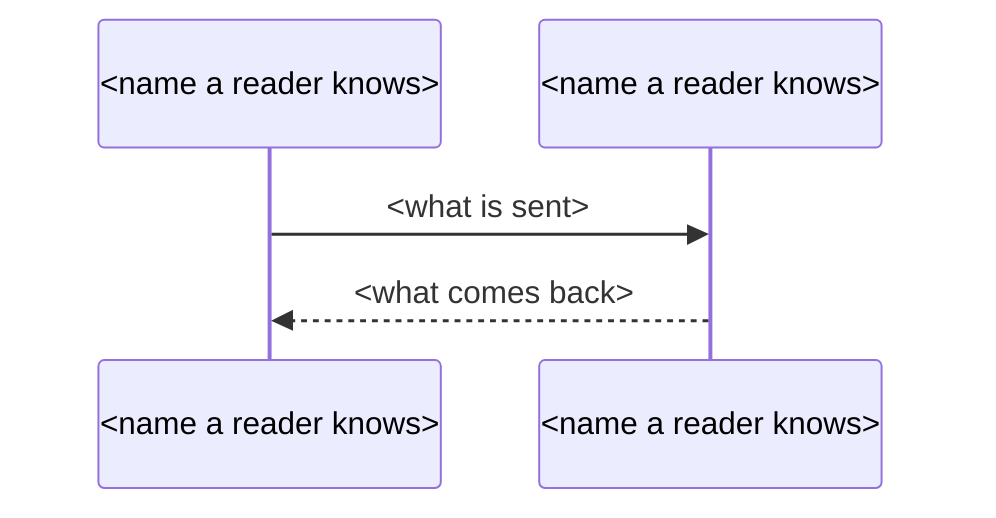

## Phase 3b: System overview, architecture and system findings

Write what you tell the user during this phase in `$LANGUAGE`, as **Language** in Phase 0 says.

The system layer is read once. One subagent reads the manifests, configuration and start-up code of each application and writes, in that one read, every file of the system layer this run selects: the system overview (section `overview`), the architecture chapter with its fact sheet (section `architecture`) and the system findings of each application root (section `system-findings`). Each file is checked by its own command and recorded with its own state and attempts; a retry asks the subagent only for the files that did not pass.

- **The overview** states the system as a whole: what it is, who uses it, which applications it is made of and which external systems it calls. The scripts check it and record it `checked`, which is final: the overview goes into the handbook as it was written, marked as not verified, and the script, not the subagent, computes every statistic next to it: each application's languages, frameworks, files and lines, its first and last commit date, commits and authors, the counts of the system and the roles of each domain. `--features` does not skip the overview: it is written whenever it is not already, even when `$SELECTED` lists one feature.
- **The architecture chapter** is how the system is built: its applications and their stacks, how the frontend reaches each backend, how the backends call each other, which databases they use, which external and cloud services they call, how it is built and deployed, and how sign-in and permissions work across the applications. The subagent writes it as a free chapter `chapters/architecture.md` and a short fact sheet `architecture.json` of components and the connections between them. The scripts check both: the chapter exactly as a feature's chapter, the fact sheet for its shape, its evidence and one component for each application root. Neither is read by anyone but the script; the handbook marks the chapter unverified, and draws the components in layers with the connections between them. Its check takes the run's language and state from the map.
- **The system findings** state the defects in the parts of each application root that no single feature owns: the start-up, the registration of routes, middleware and scheduled jobs, and the code every feature calls. The defects in one feature's own code are written by that feature's lane (Phase 4); the two do not overlap, and a script holds them apart. One file per application root (the id is `app<n>.system`, where `<n>` counts the application roots from 1 in the order `applications` prints them); the scripts check each with the checks of a finding and two more (a passage in the application, and ownership), and record the unit `checked`, which is final: the findings go into the handbook as they were written, marked as not verified. A system findings unit does not depend on an entry or on the findings of a feature. An application may have no finding: the file holds an empty list, and the script records the unit as verified at once. An application with no seed file has no file for the subagent to write.

1. Find what this run still has to write. Only the files of the sections in `$SECTIONS` are listed; a unit of a section that is not selected is not written in this run, whatever an earlier run left.
   - The overview (only with `overview` in `$SECTIONS`). A `state.json` without an `overview` key, as an output directory from before the overview has, reads as planned with no attempt:
     ```bash
     jq -r '(.overview // {status: "planned", attempts: 0}) | [.status, .attempts] | @tsv' "$OUT/state.json"
     ```
     `checked`, `confirmed` or `verified`: not written again. `dispatched` with `$OUT/entries/overview.json` present (an earlier run stopped after the subagent wrote): check it first, as step 5 describes, as if the subagent had just returned. `failed` with `attempts` 1 (an earlier run stopped before the second attempt): it is written again with the reasons `state.json` kept, `jq -r '.overview.failure.reasons[]' "$OUT/state.json"`, as the retry in step 5 gives them. Any other state with `attempts` below 2: it is written. With `attempts` 2 and not `checked`, `confirmed` or `verified`, leave it as it is; the handbook then says the overview was not written and where it stopped.
   - The architecture (only with `architecture` in `$SECTIONS`). A `state.json` without an `architecture` key reads as planned with no attempt:
     ```bash
     jq -r '(.architecture // {status: "planned", attempts: 0}) | [.status, .attempts] | @tsv' "$OUT/state.json"
     ```
     `checked`: the chapter is not written again. `failed` with `attempts` 3: leave it as it is; the handbook says the chapter was not written and keeps the diagram of applications and external systems. Anything else: it is written.
   - The system findings (only with `system-findings` in `$SECTIONS`). First list the units this run covers, `$UNITS`. Without `--applications`, they are every application root: run `applications`, read the number `<N>` on its first line, and take `app1.system` to `app<N>.system`:
     ```bash
     node "$PLUGIN_ROOT/skills/excavator-product-handbook/handbook.mjs" applications "$PROJECT_ROOT"
     ```
     With `--applications`, resolve the list with `select`, with the list as one single-quoted argument exactly as the user gave it:
     ```bash
     node "$PLUGIN_ROOT/skills/excavator-product-handbook/handbook.mjs" select "$OUT" --applications '<the --applications value>' --project "$PROJECT_ROOT"
     ```
     Exit 0: it prints the unit ids, one per line, in the order of the roots; `$UNITS` is that list. Exit 1: tell the user the lines it printed (each item that is not an application root and every root), and stop: dispatch nothing in this phase. Then read the state of each unit. `<ids>` is `$UNITS` space-separated. A `state.json` without a `systemFindings` key, as an output directory from before the system findings has, reads as every unit planned with no attempt:
     ```bash
     jq -r --arg ids "<ids>" '($ids | split(" ") | map(select(. != ""))) as $units | (.systemFindings // {}) as $found | $units[] | [., ($found[sub("\\.system$"; "")].status // "planned"), ($found[sub("\\.system$"; "")].attempts // 0)] | @tsv' "$OUT/state.json"
     jq -r '.features[] | [.id, .name, (.seedFiles | join(", "))] | @tsv' "$OUT/map.json"
     ```
     A unit that is `checked`, `confirmed` or `verified` is not written again. A unit that is `dispatched` and has a file (an earlier run stopped after the subagent wrote) is checked first, as step 5 describes. Every other unit with `attempts` below 2 is written; one with `attempts` 2 that is not `checked`, `confirmed` or `verified` stays as it is. A unit that is `failed` with `attempts` 1 (an earlier run stopped before its second attempt) is written again with the reasons `state.json` kept from the first: `jq -r '.systemFindings["app<n>"].failure.reasons[]' "$OUT/state.json"`. The second command prints each feature with its seed files, for the prompt.

     Find the seed files of each unit that is written:
     ```bash
     node "$PLUGIN_ROOT/skills/excavator-product-handbook/handbook.mjs" system-seeds "$OUT" <id> --project "$PROJECT_ROOT"
     ```
     It prints the seed files, one per line: the files of the application that hold a start-up or a scheduled job, and the files that register at least 5 entrypoints. When it prints nothing, the application has no seed file: the subagent writes no file for it. Record it as verified with no finding by running `check-system-findings "$OUT" <id> --project "$PROJECT_ROOT"`, which writes the empty file itself and prints `<id>: verified (0 findings)`, and go on with the next unit. A line that says `state.json` records another application root for the unit exits 1: the source changed since the earlier run. Tell the user the line, as printed, and stop; the run needs `--fresh`. Exit 2: the command could not run. Show its message and stop.

   `$WRITE` is the list of the files to write: `entries/overview.json`, `chapters/architecture.md` with `architecture.json`, and `entries/<id>.json` for each system findings unit with a seed file, each only when the step above says it is written. When `$WRITE` is empty, this phase has nothing to dispatch: go on to Phase 4.
2. Print what the prompt below needs, delete the files an earlier attempt left for the files in `$WRITE`, record the dispatch of each unit that has a `mark` (the overview and the system findings units; the architecture is recorded by its check alone) and dispatch ONE `excavator-handbook-writer` subagent in the foreground (never in the background: a run without a terminal stops waiting for background subagents). It is the only dispatch of this phase: never one subagent per file or per application:
   ```bash
   node "$PLUGIN_ROOT/skills/excavator-product-handbook/handbook.mjs" applications "$PROJECT_ROOT"
   node "$PLUGIN_ROOT/skills/excavator-product-handbook/handbook.mjs" names "$PROJECT_ROOT"
   jq -r '.areas[] | [.id, .name] | @tsv' "$OUT/map.json"
   jq -r '.features[] | [.id, .area, .reach, .name] | @tsv' "$OUT/map.json"
   jq -r '.roles[].label' "$OUT/map.json"
   jq 'del(.items) | del(.projectRoot)' "$OUT/candidates.json"
   rm -f "$OUT/entries/overview.json"
   rm -f "$OUT/chapters/architecture.md" "$OUT/architecture.json"
   rm -f "$OUT/entries/<id>.json"
   node "$PLUGIN_ROOT/skills/excavator-product-handbook/handbook.mjs" mark "$OUT" overview dispatched --project "$PROJECT_ROOT"
   node "$PLUGIN_ROOT/skills/excavator-product-handbook/handbook.mjs" mark "$OUT" <id> dispatched --project "$PROJECT_ROOT"
   ```
   Run only the `rm` and `mark` lines of the files in `$WRITE`; the `<id>` lines are once for each system findings unit in `$WRITE`. Fill the prompt's placeholders with those outputs, the seed files of each system findings unit and the candidates of those seed files (the candidates of `candidates.json` whose file is a seed file), and `$PLUGIN_ROOT`, `$PROJECT_ROOT`, `$OUT` and `$LANGUAGE` with their values. The block **Your files** lists the files of `$WRITE`, and no other.
3. Wait for the subagent. When it returns, check its files, the overview first, then the architecture, then each system findings unit, one command at a time, never two at once. Run only the commands of the files in `$WRITE`:
   ```bash
   node "$PLUGIN_ROOT/skills/excavator-product-handbook/handbook.mjs" check-overview "$OUT" --project "$PROJECT_ROOT"
   node "$PLUGIN_ROOT/skills/excavator-product-handbook/handbook.mjs" check-architecture "$OUT" --project "$PROJECT_ROOT"
   node "$PLUGIN_ROOT/skills/excavator-product-handbook/handbook.mjs" check-system-findings "$OUT" <id> --project "$PROJECT_ROOT"
   ```
   Each records its result in `state.json` itself: `checked`, `verified` for a system findings unit that holds no finding (there is nothing to prove), or `failed` with the lines it printed as the reasons; a subagent that wrote no file for a unit fails it with `lane-wrote-nothing`.
   - Exit 0: the unit is checked, or verified with none.
   - Exit 1: the unit failed its checks. The last line it printed is a `Next:` line. Follow it, unit by unit:
     - `Next: delete overview's entry, mark it dispatched and re-dispatch it once with the lines above (attempt 2 of 2)` (for a system findings unit `<id>` in place of `overview`): the unit is to be written again, once.
     - `Next:` lines for the architecture say to dispatch again; its limit is 3 attempts, and a `Next:` line that says the section stays failed ends it: never an attempt beyond the third.
     - `Next: overview stays failed (2 of 2 attempts)` (`<id> stays failed (2 of 2 attempts)` for a system findings unit): leave the unit failed, with its file kept for the user to see. Never make a further attempt.
     - A `Next:` line that starts `Next: write ui.json first`: the fixed text of a non-English run is missing or fails `check-ui`, nothing was recorded and this is not an attempt. Stop dispatching, go back to Phase 2, then check this unit again.
   - Exit 2: the command could not run. Show its message and stop.

   Never edit `entries/overview.json`, `chapters/architecture.md`, `architecture.json`, `entries/<id>.json` or `state.json` yourself, and never widen a passage or reword a file to make it pass. A unit that fails its checks is fixed only by its own next attempt. Statuses and attempts change only through these commands.
4. When the checks of the files left some units to write again, dispatch ONE `excavator-handbook-writer` subagent again, with the prompt followed by this line, `Your previous attempt failed these checks; fix them and write the file again:`, and then, for each unit to write again, its id on a line of its own and each line its check printed except the `Next:` line (for the architecture the line says `write the files again`). The block **Your files** lists only the files of those units: a file that passed (`checked` or `verified`) is not asked for again and its state stays. Before it, delete the files of those units (the `rm` lines of step 2 for them) and run their `mark` lines again. Check the files of those units again when it returns, as step 3 does. Never a further dispatch for a unit that has used its attempts.
5. Tell the user `Overview: <status>`, `Architecture: <status>` and `System findings <id> <n>/<N>: <status>` for each unit, where `<status>` is `checked` or `failed` (a unit with no finding counts as checked), `<n>` counts the system findings units this run has checked (an application with no seed file included) and `<N>` is the number of units listed in step 1, all said in `$LANGUAGE`.

The system prompt:

````text
You write the system part of a product handbook, for readers who do not read code, from the source and the configuration of the project at $PROJECT_ROOT, in one read of the project: the files listed below, each for the system as a whole or for one of its applications. The last block of this prompt, **Your files**, lists the files you write this time, and no others. The parts below that describe a file you are not asked for do not apply to this run: skip them. In this prompt `<id>` stands for the id of a system findings file.

The files are: the system overview (`$OUT/entries/overview.json`): what the system is, who uses it, which applications it is made of and which external systems it calls, as the code is today; the architecture chapter (`$OUT/chapters/architecture.md`) with its fact sheet (`$OUT/architecture.json`): how the system is built today, for a technical reader; and, for each application you are asked for, its system findings (`$OUT/entries/<id>.json`): the defects in the parts of the application that no single feature owns.

Your scope. Read the project once and write every file you are asked for from that one read: what you read for one file is available to the others. Start with the areas, features and roles of the map below; the head of the candidate list below; the application roots below (one line each: the directory, `.` being the project root, and its build manifests); and each application's build manifests (the dependency declarations, the container and build files, the deployment and pipeline files, and the environment configuration of each root). Then open the start-up code of each application, its route registration, its database connection and data access, the place where its table changes (migrations) live, its clients of other applications and of outside services, its sign-in and permission middleware, its scheduler registration, and its entry files. Search the whole project for the hits of external SDKs, HTTP clients, queue and mail clients and credential or endpoint configuration, and for what a single file cannot settle (for example `grep -rnIE --exclude-dir=.excavator --exclude-dir=node_modules --exclude-dir=.git --exclude-dir=vendor --exclude-dir=dist --exclude-dir=build '<pattern>' .`). For each system findings file you are asked for, start with the seed files of that application, listed in **Your files**: they hold the start-up and the scheduled work of the application and the places where many routes or pages are registered. Open a file only when a file you have read leads to it or a search finds it, and never list or walk a directory to see what is in it. Limits, counted for each file you write against the files you open for it (a file you open for two files counts for both): the overview, at most 30 files that are not build manifests; each system findings file, at most 20 files that are not seed files of its application; the architecture chapter has no limit on the number of files. Searches do not count. Read code and configuration only; never run, build or change anything in the project. Never read anything under `.excavator/`, never read a document that an Excavator skill generated (PRD.md, handbook.md, reports, findings, tours), and never read an explanatory document of the project (README, AGENTS, docs folders, `.md`, `.mdx`, `.txt`, `.rst`, `.adoc`): a document may be out of date, and the files you write say what the code and the configuration do today. Exclude `.excavator`, `.git`, `node_modules`, `vendor`, `dist` and `build` from every search.

The areas of the map (id, name): <areas, one per line>
The features of the map (id, area, how readers reach it, name): <features, one per line>
The roles of the map: <roles, one label per line>
The head of the candidate list (frameworks found, what was skipped): <the output of the jq line, as printed>
The application roots (directory, build manifests): <the output of the applications command, as printed>
The name candidates (value, source, file and line, resolved or unresolved): <the output of the names command, as printed>
The features of this handbook, each with the seed files its own lane reads, which other lanes write: <id, name and seed files of every feature, one per line>

Write in `$LANGUAGE`, in plain words for a reader who does not read code. The overview and the architecture chapter describe what the system is today. Give no advice, no opinion and no defect report there: never write what the system should do, what is old, unmaintained, risky or wrong. The system findings are the one place where defects are written, and only as **What a finding is** says.

**Following out of the seed files.** The seed files and the manifests are where you start, not a fence. When a file you have read hands part of the system or of an application to code in another file, follow it there: find where the imported module, the called function or method, or the constant, validation rule or component it uses is defined (search with `grep -rn`; in a language whose package spans the files of one directory, such as Go, the files beside a seed call each other without an import), and open that file. When code emits an event, publishes a message or puts a job on a queue, search the whole project for that name, find every listener or consumer, and write one hand-over sentence in the overview or the architecture chapter (who takes over, what it does) without describing that feature's own flow. Follow what you read to the file that defines it, as far as the facts below need. When a limit above is spent, open no more files for that file: write what is not settled in `unknowns`, and say in `searched`, in plain words, what you did not open.

**Negative and absolute statements.** Before you write that something is never called, never checked, never sent, not done, always done, the only one, that an application never calls another, that only one database exists, or that every application does something, and before you write a finding that something is missing, search the whole project (every module, middleware, interceptors, listeners and their registrations, scheduler registrations, SQL and migration scripts, configuration) for another place that does it, and keep the searched scope in mind. When you cannot settle it, do not write it as a fact or a finding: write it in `unknowns` with `item` and what you `searched`.

**Evidence, for every file with an evidence list.** Every item carries its own evidence. A passage is text copied verbatim from the file, part of a line or whole lines; a script finds it by ignoring differences in white space and line breaks, and it must occur **exactly once** in that file. When it occurs more than once, quote a longer one. A file is a path from the project root, inside the project, never under `.excavator`, `.git`, `node_modules`, `vendor`, `dist` or `build`, and never a document (`.md`, `.mdx`, `.txt`, `.rst`, `.adoc`): cite the code that shows it. An item may cite several passages; each is checked. Cite for each item the passage that by itself proves it: after the script's check nobody reads the item against the code, so the passage is the only proof a reader has. When no passage proves it, write it in `unknowns`. `E` stands for an evidence list, a non-empty array of `{"file": "<path from the project root>", "passage": "<text copied from that file>"}`.

**Numbers.** Every number in your text must occur as a number in that item's own passages (the script ignores thousands commas, and underscores between digits in the source); write numbers as Arabic numerals; a count you made, an ordinal or a date that is not in the passages is not allowed: write the sentence without it, or cite the passage that holds it.

**No code in reader text.** Everything you write that a reader reads (everything except `evidence`, and except `dir` and `callers` of the overview) contains no identifier with an underscore, no camel-case or mixed-case word, no path that starts with `/`, no file name with a source extension (.go .ts .tsx .js .jsx .java .py .sql .json .yaml .yml), no name followed by `(`, and no name of a member directory of the project (the application roots above excepted in the architecture chapter). Say it in plain words. The only exceptions are a `system` of the overview that passed its own check, the names of languages, frameworks, libraries, products and services as their makers spell them in the architecture chapter, and the names the map lists. Never print a raw code, flag, environment variable or `field=value`: write what it sets. Every narrative value of the files is written in $LANGUAGE.

**Secrets.** Configuration files can hold passwords, keys, tokens and connection strings with credentials. Never copy a secret value into any file: write what the setting is for, cite its line, and in a passage quote only the part of the line before the value (the name of the setting), never the value itself.

### The overview

It says what the system is, who uses it, which applications it is made of and which external systems it calls, as the code is today. Write one JSON file, `$OUT/entries/overview.json`, with exactly these keys, and no others:

```json
{
  "format": "excavator-product-handbook-overview/1",
  "id": "overview",
  "name": {"text": "<the value of one name candidate, copied exactly>", "evidence": E},
  "summary": [{"text": "<one plain sentence: what the system is and does>", "evidence": E}],
  "audiences": [{"who": "<a kind of user: staff, customers, partners, other systems>", "does": "<what they do in the system>", "evidence": E}],
  "applications": [{"dir": "<a directory that holds a build manifest: an application root above, or one below it; . is the project root>", "name": "<the application's name as readers know it>", "does": "<what it is responsible for>", "evidence": E}],
  "integrations": [{"system": "<external system as the source writes its name>", "use": "<what the system uses it for>", "callers": ["<the dir of an application listed above>"], "evidence": E}],
  "unknowns": [{"item": "<what the code does not settle>", "searched": "<what you searched>"}]
}
```

Every key is always there: write an empty list when nothing applies (`"integrations": []`), never leave a key out and never add one. `summary` has one to three items; `applications` has at least one. `unknowns` has no evidence.

**Applications.** Every application root listed above must be covered: list at least one application whose `dir` is that root or lies below it (a repository that holds several applications can list each of them, a directory below the root that holds its own build manifest). Two applications never name the same directory, and a `dir` must hold a build manifest: a directory with none is refused. Each application is named by what readers call it and says what it is responsible for.

**External systems.** An integration is a system outside the project that the code calls or is called by: a payment or messaging service, a mail or storage service, an identity provider, another company's API. `system` is its name exactly as the passage writes it, so the name must occur in the item's own passages (a name that is not in the quoted lines is refused). `callers` lists the `dir` of each listed application that calls it, at least one. Cite the line that calls it (the client call, the SDK construction, the endpoint or credential setting), not a list of dependencies.

**System name.** `name` is the name readers know the system by, taken from the name candidates above, and nowhere else: never from a document, a directory name or your own wording. `text` is the value of one candidate, copied exactly as the list prints it, in whatever case and language the code spells it; it is not translated, not shortened and not rephrased, and none of the reader-text rules above applies to it. `evidence` is exactly one passage, not several: the line of that candidate in its file (the file and line are on its row), which must hold the value. Choose the full product name a reader would recognise rather than a package name, a module name or an abbreviation when the candidates offer one; never choose a candidate marked `unresolved`, which is a reference to a variable, not a name. When no candidate looks like the name of a product, write `"name": null` and add an item to `unknowns` that says which candidates you looked at and why none is the name.

**Evidence for the overview.** A statement about the system as a whole ("a tool for ...") is hard to prove from one line; cite the entry file or the route table that shows what it does, and keep the sentence to what that code shows.

**Only what the quoted lines show.** Every detail you add is one more thing the quoted lines must show, and a reader who compares the item with them finds the detail they do not show. So:
- A `summary` sentence names only what its passages name. Cite the menu or the route table and name the parts it lists; never write "all", "every" or a list longer than the lines you quote. Two short sentences that each cite their own table are better than one long one.
- An application's `does` says what its entry file or route table shows it serving; never "all the pages" or "every service" unless the quoted lines are the whole list.
- An audience cites the check that lets that kind of user in (the role test, the guard, the login of that kind of account) together with the route or screen of what they do there; do not add what they can see or not see unless the quoted check shows it.
- An integration's `use` says what the quoted call does (sends a message, uploads a file, asks for a completion), not who it is for or what triggers it, unless those are in the quoted lines too. Name the provider only as the passage writes it: a mail client that sends over SMTP is not proof of a particular mail service.
- When one item needs a fact the passage does not show, leave that fact out of the item, or move it to `unknowns`.

Every `system` must occur in that item's own passages. The narrative values of the overview, `summary` texts, `who`, `does`, `name`, `use` and the unknowns, are written in $LANGUAGE; `system`, `dir` and `callers` stay as the source and the list above write them.

### The architecture chapter and its fact sheet

The chapter tells a technical reader how the system is built today: what it is made of, how the parts reach each other, where the data lives, which services outside the project it uses, how it is built and deployed, and how sign-in and permissions work across the parts. Never write what is old, unmaintained, risky or wrong. You write two files. The chapter, `$OUT/chapters/architecture.md`, is where everything a reader learns goes. The fact sheet, `$OUT/architecture.json`, lists in short the components and the connections the handbook draws as a diagram; every component and every connection in it is also in the chapter. Write the chapter first, then the fact sheet.

**What the chapter covers.** As far as the code and the configuration show it:
- every application: its language and framework, each with the version its manifest declares; what it is responsible for; the port it listens on;
- how the frontend reaches each backend: where the address of each backend comes from (environment configuration, a proxy, a request wrapper), written per backend;
- which backend calls which other backend, for what, and how the call is authenticated;
- every database: which backends connect to it, how each one reads and writes it (the data access library), where the table changes are kept, and any second database a backend reads;
- caches, queues and schedulers: which application runs scheduled work, with which scheduler;
- every external service and every cloud service (storage, mail, logs, content delivery): what the system uses it for and which applications call it;
- how each application is built and deployed: the container files, the pipelines, the deployment descriptors, and which environments they name;
- sign-in, tokens and permissions: which application issues tokens, how the others check them, where the permission rules are kept and how a request is judged against them; other ways in, such as shared links or a separate sign-in for customers.
Write every version and every port with the line that declares it as its citation.

**How the chapter is written.** Markdown in $LANGUAGE, with headings of your choice from `#` to `####`. Every sentence that states a fact ends with its citation group: one or more citations, each in backticks, written as the file's path from the project root, a colon and its lines (`<path>:<a>-<b>`, or `<path>:<n>` for one line), several separated by "; ", the group in parentheses, for example: The service listens on port 8080 (`api/config/server.yaml:3`). A citation covers at most 80 lines: cite the lines that say the fact, not the whole file. Backticks are for citations only: anything else in backticks is read as a citation and refused, so quote names with quotation marks. A table row is cited like a sentence: put its citation group in its last cell. A line that ends with a colon and introduces a list, a table or a diagram needs no citation; every other sentence does, and every heading needs at least one cited sentence under it. The only fenced blocks are the sequence diagrams below.

**One fact per sentence.** A sentence states one fact, and its citations prove that fact. A sentence that holds two facts becomes two sentences, each with its own citations.

**Shape the text for a reader who scans.** Choose the form by what the facts are, not prose by default. A set of things of one kind (applications, services, environments, pipelines) is a list, one item per line. Things that share the same attributes are a table, one row each and one column per attribute: an application with its stack, versions, responsibility and port; a service with its use and its callers. The steps of a flow are a numbered list, one step per item. What remains is prose, in paragraphs of at most 3 sentences on one line; a blank line ends a paragraph. Introduce a list or a table with one line that ends with a colon. Put a heading over every group of about 8 items, so no heading holds a long run of text. Every list item and every table row is cited like a sentence.

**Sequence diagrams.** Draw the path of one request, from the browser through the frontend to a backend, the token check and the database, and draw sign-in when it crosses applications. Use only this subset of mermaid:



Every participant is declared as `participant <Name> as <display name>`. Every arrow is `->>` or `-->>`, and the line right after it is `%%` followed by the arrow's citation group and nothing else. Never use `alt`, `else`, `opt`, `loop`, `par`, `rect`, `note`, `activate`, `autonumber` or any other keyword. A chapter with no request path worth a diagram has instead one line `<!-- no-diagram: <reason> -->`.

**Cite what proves it.** A later check sees only one sentence and the lines it cites. So cite, for each sentence, the lines that by themselves prove it: for a connection, the client call, the address setting or the connection string, not a dependency list; for a version, the manifest line; for a deployment, the line of the deployment file. A library in a dependency list proves only that it is declared, not that a service is called. When no line proves it, leave it out of the chapter and write it in the fact sheet's `unknowns`.

**Names and numbers in the chapter.** Write the names of languages, frameworks, libraries, products and services as their makers spell them. Write numbers as Arabic numerals, and only numbers that occur in the lines you cite.

Write one JSON file, `$OUT/architecture.json`, with exactly these keys, and no others:

```json
{
  "format": "excavator-product-handbook-architecture/1",
  "components": [{"id": "<c1, c2, ...>", "label": "<the name a reader knows it by>", "kind": "<users | frontend | backend | library | database | external | cloud>", "application": "<an application root above; only on a frontend, backend or library>", "stack": "<its language, framework and versions, in a few words>", "evidence": E}],
  "links": [{"from": "<a component id>", "to": "<a component id>", "text": "<what goes over it, at most 16 characters>", "evidence": E}],
  "unknowns": [{"item": "<what the code does not settle>", "searched": "<what you searched>"}]
}
```

**Components.** Every application root above is exactly one component of kind `frontend`, `backend` or `library`, with `application` set to that root; a `library` is a shared code package that other applications import and that runs no server of its own, and it is drawn beside the backends; no other component has `application`. A component of kind `users` is a kind of person or outside program that uses the system, cited at the check or the route that lets it in. A `database` is a database a backend connects to, cited at its connection setting. An `external` is a service of another company; a `cloud` is a hosting, storage, mail, log or content delivery service. `stack` is empty for a component that is not an application. Ids are unique.

**Links.** A link goes from the component that calls or sends to the component that is called or receives: users to the frontend, the frontend to each backend it calls, a backend to the backend it calls, a backend to each database it connects to and to each service it calls. `from` and `to` are ids of components above, never the same one, and each ordered pair occurs once. `text` says in at most 16 characters what goes over it; the details are in the chapter. Cite the line that makes the call or holds the address.

Every component and every link carries its own evidence. Every narrative value of the fact sheet (`label`, `stack`, `text`, the unknowns) is written in $LANGUAGE, apart from the names of products and technologies, which stay as their makers spell them.

### The system findings of an application

What you write for an application is the defects in the parts of it that the features share: start-up and shutdown, the reading of configuration, the registration of routes and middleware (which group of routes carries which middleware), the registration of scheduled jobs, and the shared code that the seed files hand work to (authentication, error handling, the sending of messages, calendar and time zone). A defect that lies only in the code of one feature belongs to that feature's lane: do not write it. A finding cites at least one passage in a file under the application's root directory, and a script refuses a finding whose every cited file is a seed file of one feature and none of them a seed file of this application.

**What a finding is.** A finding is something the code does today that is wrong, that a reader can reproduce from your words. Examples: the same thing done two ways in two places; a check on one side that the other side lacks; a failure that still answers success; a caller and a callee that do not match; a value written into the code that should come from data. It is not a matter of style or readability, and not a "may" or "might": when you cannot show that the code does it, it is not a finding. Write only the findings you can prove; an application with no defect has an empty list, never pad it.

**Categories.** Each finding has one category, the root cause, exactly one of these words:
- `authorization`: no check of who owns the record, who is assigned to it or which role acts;
- `error-handling`: an error is swallowed, or a failure answers success;
- `notification`: a notification is not sent, goes to the wrong people or says the wrong thing;
- `consistency`: data becomes inconsistent through a transaction, concurrency, a repeated request or a replay;
- `calculation`: a calculation or a statistic is wrong;
- `hard-coded`: a value written into the code, a placeholder feature, code that cannot be reached;
- `contract`: the caller and the callee do not match: path, method, parameter or field;
- `security`: secrets, injection, transport or infrastructure;
- `display`: a defect of the page's interaction or display;
- `time`: a defect of dates, time zones or calendar rules;
- `other`: none of the above.

Write one JSON file for each application you are asked for, `$OUT/entries/<id>.json`, with exactly these keys, and no others:

```json
{
  "format": "excavator-product-handbook-findings/1",
  "id": "<id>",
  "findings": [{"category": "<one of the words above>", "text": "<what the code does that is wrong, and in which situation it happens>", "evidence": E}],
  "unknowns": [{"item": "<what the code does not settle>", "searched": "<what you searched>"}]
}
```

Every key is always there: write an empty list when nothing applies (`"findings": []`), never leave a key out and never add one. `unknowns` has no evidence.

**The statement.** `text` says the defect itself and the situation in which it happens, so that a reader can reproduce it: what the reader does or what arrives, and what the code then does. It never says how to change it and never judges it: no "should", "must", "needs to", "better", "fix", "recommend" or "consider"; a script refuses the words of its list and names the one it found. One finding is one defect: two defects are two findings.

**Cite what proves a finding.** Nobody reads a finding against the code after the script's check, so the passage is the only proof a reader has. Cite the passage that by itself shows the defect. For a missing check, cite the whole piece of code that performs the write or the action, so that the reader sees that no check is in it. For two places that disagree, cite both. For a failure that answers success, cite the failing call and the answer. When no passage proves it, write it in `unknowns`. When the statement uses a word of scope (all, every, never, always, only and the like, in $LANGUAGE), cite the lines that decide when it happens, for example the condition that puts the thing on the page or the assignment; a reader tests each such word against every case the code handles. When no passage proves that scope, leave the word out and state only the case the passages show.

### Your check, and your reply

**Check your files before you reply.** Run, for each file you write, the command of its kind, and fix the file for every line it prints and run it again until it prints its `ok` line, at most 5 runs for each file. Each runs the checks the orchestrator runs on your file and records nothing:
- the overview: `node "$PLUGIN_ROOT/skills/excavator-product-handbook/handbook.mjs" try-overview "$OUT" --project "$PROJECT_ROOT"`, which prints `overview: ok`;
- the architecture: `node "$PLUGIN_ROOT/skills/excavator-product-handbook/handbook.mjs" try-architecture "$OUT" --project "$PROJECT_ROOT"`, which runs on both files and prints `architecture: ok`;
- the system findings of an application: `node "$PLUGIN_ROOT/skills/excavator-product-handbook/handbook.mjs" try-system-findings "$OUT" <id> --project "$PROJECT_ROOT"`, which prints `<id>: ok`.
When $LANGUAGE has its own script, the overview and the system findings checks also refuse a narrative value that is written only in ASCII letters. A passage reported as not in its file is most often a real line that sits in another file: search for it (`grep -rnF`) and cite the file it is in. A citation of the architecture chapter reported as out of range or too long: open the file again and cite the lines that say the fact. A line that starts `note:` does not fail the check: it says that a number, a quoted name, a code-shaped word, a word of advice or the language of a sentence does not match its citations. Fix it when the fix is to cite the lines that hold it or to say it in plain words; a note about the name of a product or technology spelled as its maker spells it may stay. Never drop a fact only to silence a note, and never cut a passage down until it happens to match. An item whose source you cannot find leaves the file, or goes into `unknowns`.

Write only the files listed in **Your files**, and nothing else anywhere. Reply with one line for each file you wrote and nothing else: `overview: written`, `architecture: written`, `<id>: written` (the id of the system findings file).

**Your files.** The files you write this time, and no others:
- <one line for each file of `$WRITE`: `$OUT/entries/overview.json` (the overview); `$OUT/chapters/architecture.md` and `$OUT/architecture.json` (the architecture chapter and its fact sheet); for each system findings unit: `$OUT/entries/<id>.json` (the system findings of application <id>, whose root directory is `<dir>`), its seed files: <seed files, one per line>, and its entrypoints in the seed files: <the candidates of the seed files, one per line: id, kind, file:line, text>>
````

---
