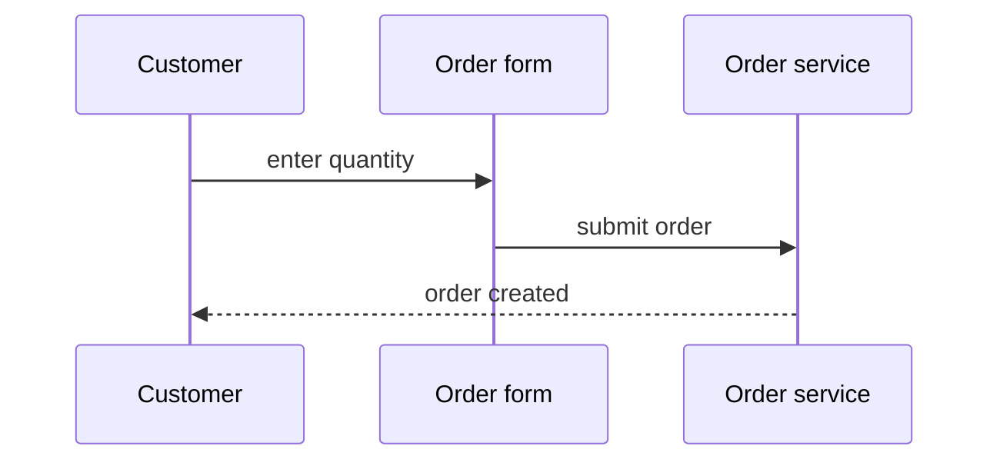

## Order placement

A customer fills in the order form and submits it; the order is created with the status open.

### Flow 1: Place an order

Evidence

- Order form check — `web/src/OrderForm.tsx:2-4`
- Order route — `src/orders/routes.js:5`
- Order creation — `src/orders/service.js:3-8`

