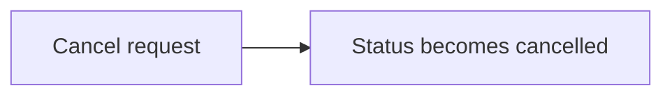

## Order cancellation

A support agent cancels an order; its status becomes cancelled.

### Flow 1: Cancel an order

Evidence

- Cancel route — `src/orders/routes.js:6`
- Status change — `src/orders/service.js:10-13`

